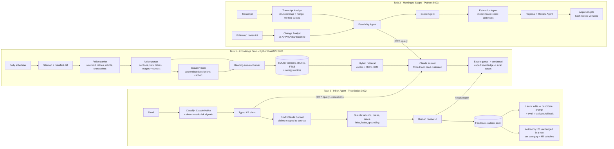

# Design

## 1. The business problem
Northstar Web Studio (fictional) builds and supports directory websites on Brilliant Directories (BD). Three jobs eat its people's time:

1. **Finding product answers.** The answers are in ~hundreds of BD help articles, and some only in their screenshots (a setting's exact label). Articles change.
2. **Answering customer email.** Read, classify, look up facts, write, and don't promise anything you can't deliver (refunds, prices, dates).
3. **Turning meetings into proposals.** "Make search better" has to become requirements, a check of what BD already does (so we don't quote custom work for a setting), an estimate, a proposal, and later a clean record of what the client changed.

The design goal is **fewer hours per reply/proposal without new risk**: every fact cited, every commitment approved by a person, every change traceable.

## 2. Architecture

**Why one shared Knowledge Brain behind an API.** Product knowledge has one owner, one freshness schedule and one citation format. The inbox and the scope builder each have a typed client (`knowledge-client/client.ts` validates every response with zod; `scope/kb_client.py` checks the contract) and never touch Task 1's database. When an article changes overnight, both downstream apps see it on their next call, with no copy to keep in sync. Another business could reuse the Knowledge Brain by pointing `KB_SITEMAP_URL` at its own help centre.

## 3. Task 1: Knowledge Brain
- **Ingestion.** The sitemap is diffed against a persistent manifest (`pages`): new and changed (by `lastmod`) pages are fetched; unchanged pages cost nothing; missing ones are deactivated. Every page commits its own status, so an interrupted crawl resumes where it stopped. Politeness: 2 concurrent requests and 1 s between requests to the help centre (per-host limiter), exponential backoff with jitter and `Retry-After`, no retries on 4xx, `robots.txt` honoured, conditional GETs. A run refuses to deactivate more than 30% of the corpus at once (protects against a broken sitemap), and any run can be rolled back because every parsed article is stored as a version.
- **Idempotency.** The content hash covers title, section text and image keys (URLs without volatile query strings). Same hash means no new version and no new chunks, even in `full` mode.
- **Screenshots.** Each content image is downloaded, type-checked by magic bytes, and described by Claude Haiku *with the text around it* ("Text before the screenshot: Click Actions » Payment History"), transcribing visible labels and reporting uncertainty instead of guessing. Descriptions are cached by image URL. They are indexed twice: as their own `image` chunks (for "what does this screen look like") and inlined into the text chunk they illustrate (so step-by-step answers include the exact labels).
- **Chunking.** Heading-aware: one section per chunk, small sections merged forward, long ones split on block boundaries with one block of overlap. An intro line ending in ":" stays with its list; screenshots stay with their step; table headers repeat on every split. Each chunk is embedded as "Title > Section + text". A fixed-window strategy is kept for comparison.
- **Retrieval.** Local `bge-small-en-v1.5` embeddings (fastembed: free, no extra key; Voyage optional) plus SQLite FTS5/BM25, fused with Reciprocal Rank Fusion, max 3 chunks per article so multi-article questions get breadth. Vector, keyword and hybrid are all selectable so the eval can compare them.
- **Answering.** A similarity gate abstains without calling the model when nothing is relevant. Otherwise Claude must answer through a `submit_answer` tool: status, answer with `[S#]` citations, unsupported points. Code rejects citations to sources that weren't provided and "answered" with no citation, and gives the model one corrected retry. Retrieved text sits inside `<evidence>` tags declared as untrusted data (prompt-injection defence). There is no invented confidence number.
- **Escalation and learning.** Anything not fully answered opens (or reuses) an expert task. The expert's answer becomes a separate, versioned `expert_knowledge` record; only answers marked "reusable product fact" are indexed (customer-specific ones are not), they can expire, older versions are superseded, and the question is appended to the eval set.

## 4. Task 2: Inbox Agent
- **Pipeline.** Classify (category, urgency, risk, sentiment, flags, product questions) → look up each product question in Task 1 → draft → guards → review. Deterministic regex signals (legal threat, chargeback, account security, prompt injection) are merged into the model's flags and can only *raise* risk.
- **Grounding contract.** The draft lists every product claim with the `K#` knowledge sources that support it; unknown ids trigger a corrective retry. Links must be retrieved sources or the company domain.
- **Guards** (code, not the model): refund/credit/cancellation promises, money amounts, dates and turnaround times, effort estimates, internal leaks ("knowledge base", "K1"), card numbers/credentials, ungrounded claims, knowledge gaps. *Block* issues need an explicit "I've checked this" before a human can send; any warning disqualifies autonomous sending.
- **Knowledge Brain down.** The agent doesn't improvise: it produces a no-facts holding reply, marks it blocked, and lets the reviewer retry later. Holding replies never count toward autonomy.
- **Learning without retraining.** Every decision is stored with draft text, final text, word-level edit ratio, reason, prompt version and model. Two mechanisms use it: (1) the two most recent approved replies in the same category are given to the drafter as style examples, (2) `npm run learn` turns recurring edits into a *candidate* prompt version (new style guidelines; guidelines that would weaken grounding or commitment rules are rejected), which must beat the active version on the held-out emails (`npm run eval -- --prompt v2`) before someone activates it; rollback is re-activating the old version.
- **The 20-in-a-row rule, made auditable.** "Same kind" = same category. "Without changing" = the text actually sent equals the draft after normalising only line endings, trailing spaces and blank-line runs; the approve button is never trusted on its own. Edits, rejections, escalations and flagged audits reset the streak. At 20 a category becomes *eligible*; a named person must switch it on. Even then a draft auto-sends only if it is low risk, has no warnings, has no legal/security/chargeback/injection flag and the knowledge lookup fully answered. Refund/cancellation, complaint, quote and project emails can never auto-send. Every 5th autonomous send (starting with the first) goes to a post-send audit; a flagged audit, any edit, or an edit rate above 20% over the last 10 reviews switches autonomy off. Sends are idempotent (one send per draft, enforced by a UNIQUE constraint). Every event is in the audit log, with email addresses and phone numbers masked.

## 5. Task 3: Meeting to Scope - the agent team
| Agent | Input → output | Validation in code |
| --- | --- | --- |
| Transcript Analyst | transcript chunks (~6k chars, 3-line overlap, run in parallel) → typed items with line numbers and quotes; then a merge step → requirements with REQ ids | line numbers must be in the chunk; every quote is located in the transcript (±4 lines) and marked verified or not; who said it comes from the transcript, not the model |
| Product Feasibility | each requirement → Task 1 `/query` → configuration / existing-with-limitation / custom / needs-clarification | "existing" requires an answered lookup and a cited URL; "not found" never becomes "doesn't exist" |
| Scope | confirmed requirements + feasibility → deliverables, exclusions, assumptions, client responsibilities, risks | only confirmed requirements become deliverables (unclear → "waiting for confirmation"); coverage and vague-acceptance-criteria checks |
| Estimation | deliverables → tasks with low/likely/high hours | the model never does arithmetic: totals, PERT, contingency (10% + 3% per unconfirmed deliverable, capped) and price are computed in code |
| Proposal + Review | structured data → narrative only; tables/numbers rendered from data | narrative containing any price/hours or unstated date is a blocking issue; a Haiku reviewer checks narrative vs data |
| Change Analyst | follow-up items vs the **approved** baseline → added / removed / modified / conflict + schedule change | baseline ids must exist; unchanged deliverables keep their approved tasks verbatim; additions are flagged as outside the approved scope |

**Approval is enforced in the data layer, not the UI.** A version is approved by a named reviewer, which stores its content hash. Any later edit (e.g. adjusting task hours) drops it back to draft. Only an approved version whose hash still matches can be sent, and only once. Follow-up analysis refuses to run until a baseline is approved, so an unapproved AI suggestion can never become the agreed scope.

## 6. Model and storage choices (hypotheses tested in EVALS.md)
| Use | Default | Why | Compared against |
| --- | --- | --- | --- |
| KB answers | Claude Sonnet 5.5 | grounding and abstention quality matter more than cost per question | Haiku 5.5 |
| Screenshot descriptions | Claude Haiku 5.5 | thousands of images, cached once, simple transcription | n/a (spot-checked) |
| Email classification | Claude Haiku 5.5 | short structured task, high volume | keyword baseline, Sonnet 5.5 |
| Email drafting | Claude Sonnet 5.5 | tone + policy compliance | Haiku 5.5 |
| Scope agents | Claude Sonnet 5.5 (review: Haiku) | long-context extraction and change detection | Opus 5.5, Haiku 5.5 |
| Embeddings | bge-small (local) | free, private, good on short technical text | Voyage (optional) |
| Store | SQLite + FTS5 + numpy | one-command install, transactions, keyword search built in; a few thousand chunks fit in memory | pgvector (upgrade path) |

Structured output is always forced tool use with a schema (zod / pydantic) plus business validation and one corrective retry; temperature 0 where the model allows it; system prompts are cached. Prompts are versioned in code (`answer-v2`, `extract-v1`, ...) or files (`prompts/draft.v1.md`) and every result records the version and model that produced it.

## 7. What was deliberately left out
- **Real email and CRM integration.** Sending is simulated (`.eml` files) so the safety logic can be demonstrated without risk; swapping in SMTP/Gmail is one function (`Outbox.deliver`).
- **Automatic state-board licence checks, Square payments, booth inventory**: these appear in the meetings as items the system must *flag*, not build.
- **Reranker.** Hybrid RRF first; a cross-encoder or Claude reranker is a measured next step only if Hit@5 shows the need.
- **Authentication/roles in the UIs.** Reviewer names are recorded on every decision but not authenticated; the KB API supports a shared key.
- **Fine-tuning.** Learning is done with versioned prompts and examples, which are auditable and reversible.

## 8. Limitations and risks
- The crawl, vision and every number in EVALS.md must be run on a machine with network access and a key; in the build environment only unit tests and stand-in runs were possible, and stand-in runs are labelled and never reported as results.
- The parser targets the Freshdesk article layout with generic fallbacks; `python -m kb.cli inspect <url>` shows exactly what will be indexed for any page.
- The similarity gate thresholds are defaults per embedder, not yet calibrated on the eval set.
- Hours attributed to a single requirement in the change report are approximate (deliverable hours split evenly across its requirements); deliverable and project totals are exact.
- Gold annotations and the reference estimate bands were written by the project author from the transcripts, not by an independent reviewer.
- SQLite with a single writer is fine for one team; multiple app servers would need Postgres.

## 9. Next steps
Calibrate the abstention gate on the eval set; add a reranker if retrieval misses; real Gmail/IMAP intake with thread matching; per-subcategory autonomy (e.g. "how-to: payments") once volumes justify it; pull time-tracking actuals into the estimator so estimates are compared with delivered hours; expose the Knowledge Brain to other businesses by making the source sitemap and branding per tenant.
